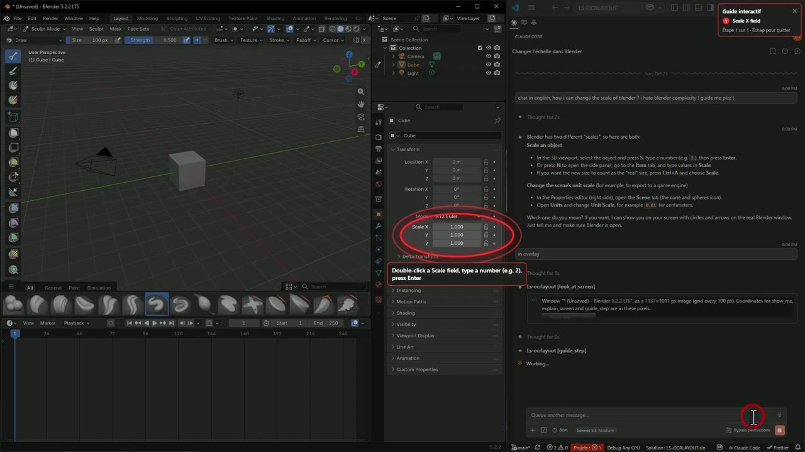
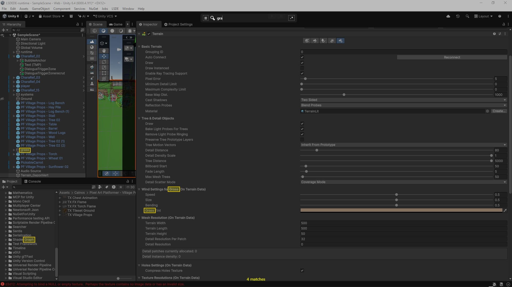
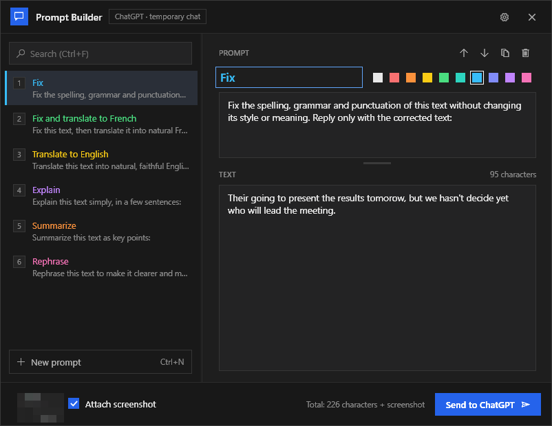

# Assistance overlay

Lost in a complex app? Ask your AI agent (Claude Code, Cursor…) "where do I click?": it looks at the app's window and circles the spot on your real screen, in any app.

[](LSOCR-guide.mp4)

▶ [Watch it in action](LSOCR-guide.mp4) (25 s, Blender)

- **Show me where**: the agent brings the app to the front, looks at its window, and circles the spot on your screen in red. `Esc` or a click closes it.
- **Explain this screen**: the agent frames each part of the app in its own color, numbered, with what it is for in a legend.
- **Step by step**: ask "how do I change…" and the agent walks you there. It circles each click on the live app, you click the real button, and the next step appears. A panel at the top right lists the steps; `Esc` or its ✕ leaves the guide.

Set it up once: [install the app](#install), tick **⚙ > MCP server** in the Prompt Builder (**Ctrl+Alt+G**), and give your agent the line the window shows, e.g. for Claude Code:

```
claude mcp add --scope user --transport http ls-ocrlayout http://localhost:47821/mcp
```

The server only answers this computer and is off at every start: an agent can look at your windows only while the box is ticked.

# ScreenSearchOverlay

Ctrl+F for your whole screen, plus ChatGPT one keystroke away.

- **Ctrl+Alt+F** — search any text visible on screen (OCR), click a match to copy it. **文A** translates the whole screen in place, in any app.
- **Ctrl+Alt+G** — send the selected text to ChatGPT with one of your saved prompts.


[](preview.jpg)

## Install

Download `ScreenSearchOverlay.exe` from the [latest release](../../releases/latest) and run it. Portable, nothing to install. It updates itself: when a new version is out, click **Version x.y.z available** in the Prompt Builder.

To have it ready at every sign-in, tick **Start with Windows** in ⚙ or in the tray menu. Untick it before deleting the exe.

## Verify the download

From version 1.6.3, the exe is signed by its author, Jon Lepage. Windows still says **Unknown publisher**: the certificate is self-issued, not bought from an authority. What proves a copy is genuine is its certificate's thumbprint, which must be:

```
7A95A361A4C5D1BE52E5500436E430F63F3E1988
```

Right-click the exe > **Properties** > **Digital Signatures** > **Details** > **View Certificate** > **Details** > **Thumbprint**, or in PowerShell:

```powershell
(Get-AuthenticodeSignature .\ScreenSearchOverlay.exe).SignerCertificate.Thumbprint
```

Another thumbprint, or no signature on 1.6.3 or later: the file is not genuine, don't run it.

## Screen search — Ctrl+Alt+F

| | |
|---|---|
| Type | Highlight matches (`.*` for regex) |
| Click a match | Copy it |
| `文A` | Translate the screen (French by default, `translateTarget` in `settings.json`) |
| Mouse wheel | Scroll the app underneath |
| `↑` / `↓` | Search history |
| `Esc` / right-click | Close |

The ☰ menu copies all text, and sets zen mode and sizes. OCR languages are in the tray menu.

**Japanese or other Asian text?** Windows needs that language's OCR pack. From an admin PowerShell:

```powershell
Add-WindowsCapability -Online -Name "Language.Basic~~~ja-JP~0.0.1.0"
Add-WindowsCapability -Online -Name "Language.OCR~~~ja-JP~0.0.1.0"
```

## Prompt Builder — Ctrl+Alt+G

[](prompt-builder.png)

Select text anywhere, press **Ctrl+Alt+G**, pick a prompt, **Send**. ChatGPT opens in its own window with your prompt and text (and the screenshot, if ticked).

Nothing selected: your last text is still there. Each prompt keeps its last 100 texts, as a terminal keeps its commands: **▲ ▼** above the text, or `↑` / `↓` in it.

| | |
|---|---|
| Type, `↑` / `↓` | Find and pick a prompt |
| `↑` / `↓` in the text | Previous texts of this prompt (from its first / last line) |
| `Enter` / `Ctrl+Enter` | Send |
| `Ctrl+1`…`9` | Pick the n-th prompt |
| `Ctrl+N` / `Ctrl+D` | New / duplicate |
| `Alt+↑` / `Alt+↓` | Reorder |
| `Del` | Delete (with undo) |

Click the screenshot thumbnail to capture a region of the screen instead (Windows' snipping tool): it is attached right away.

Prompts are edited in place and saved as you type. **⚙** holds the language (16 of them), the theme (dark / light / Night Dev / VS Code), start with Windows, temporary chat, automatic send (text / with an image), clipboard image first (use your Win+Shift+S capture instead of a new screenshot), text size and updates.

### Add prompts from an AI agent

With the MCP server on (set up in **Assistance overlay** above), ask your agent "add a prompt that…": it appears in the Prompt Builder right away. The agent can list, add and edit prompts, never delete them.

## Privacy

Nothing leaves your machine while you search. **文A** sends the screen's text to Google Translate; **Send** sends your message (and screenshot) to ChatGPT. While the MCP server is on, an agent asked to show you where to click sends a capture of that app's window (or of your screen) to its AI. Your ChatGPT login stays in `ScreenSearchOverlay.WebView2/`, next to the exe, and your recent texts in `prompt-history.json`.

## What's new

See [CHANGELOG.md](CHANGELOG.md).

## Build

Needs the .NET 10 SDK. The version comes from `package.json`.

```powershell
dotnet publish ScreenSearchOverlay.csproj -c Release -r win-x64 --self-contained true -p:PublishSingleFile=true -p:IncludeNativeLibrariesForSelfExtract=true
```

The exe lands in `bin/Release/net10.0-windows10.0.19041.0/win-x64/publish/`, unsigned: only the author's builds carry the signature above.
